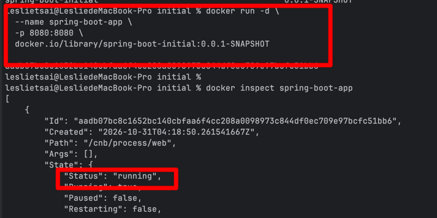
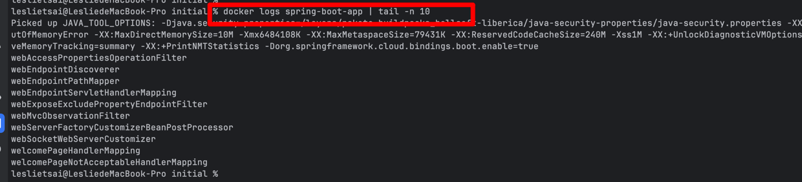

first commit

scond commit

use maven plugin to build docker image

1202  mvn spring-boot:build-image
1203  mvn spring-boot:build-image
1204  docker images
1205  docker run -d \\n  --name spring-boot-app \\n  -p 8080:8080 \\n  docker.io/library/spring-boot-initial:0.0.1-SNAPSHOT
1206  docker inspect spring-boot-app
docker logs spring-boot-app | tail -n 10
docker ps -a     , check whether a container is running or not
